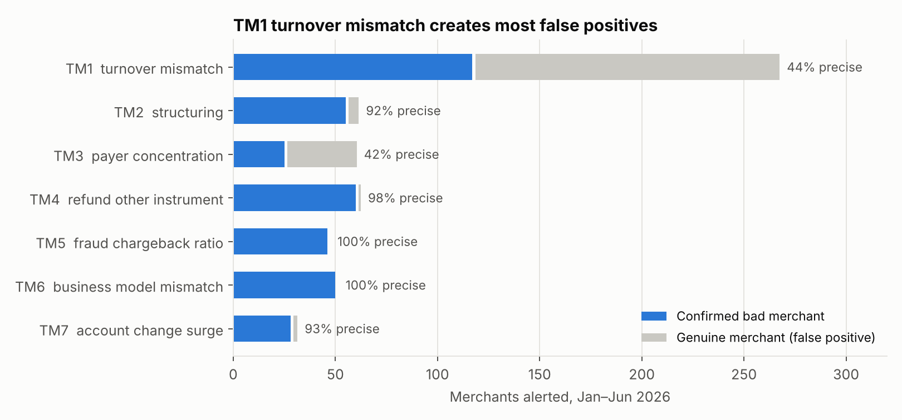
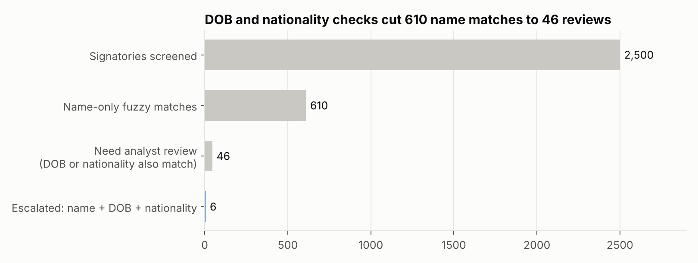
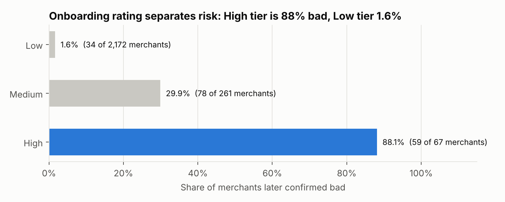
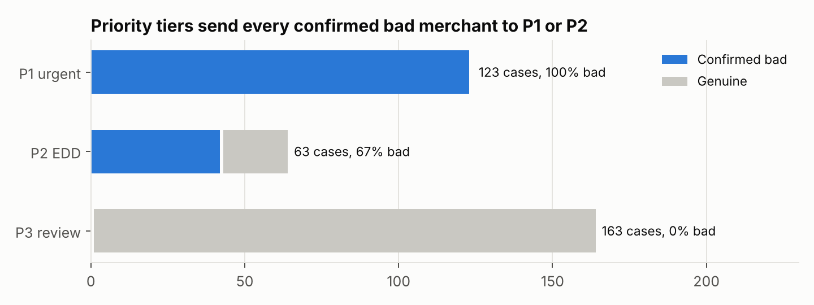

# Merchant Risk & AML Monitoring for a Payment Aggregator

How a payment aggregator's risk team could vet merchants at onboarding, screen their
signatories against sanctions and PEP lists, monitor transactions for money laundering and
merchant fraud, and decide which cases to escalate first.

Built on a synthetic portfolio of **2,500 merchants and 1.7 million payments (₹549 crore)**
over January–June 2026. All SQL rules write a plain-language reason for every alert, so each
blocked or held merchant can be explained to the merchant, an auditor or a regulator.

> **Data note.** Everything is synthetic, generated by `src/generate_data.py` with a fixed seed.
> Merchant names, people and the sanctions / PEP watchlist are invented. Bad merchants are
> over-sampled (171 of 2,500) so every typology is visible; the rates are not realistic.

## Headline findings

1. **Onboarding rating works as a first filter.** 88% of merchants rated High at onboarding
   were later confirmed bad, against 1.6% of those rated Low. High and Medium are 13% of
   merchants but hold 80% of the bad ones. **Gap:** 58 of 60 fake stores were rated Low or
   Medium, so website checks need strengthening.
2. **Name-only sanctions screening is unworkable; exact matching is unsafe.** Fuzzy name
   matching flagged 610 of 2,500 signatories (24%). Adding date of birth and nationality cut
   that to 46 reviews and kept all 6 true matches. Half of those true matches were spelled
   differently from the list, so exact-name screening would have missed them.
3. **Seven SQL monitoring rules caught all 165 laundering and fake-store merchants** before
   94% of their ₹122 crore had been processed, if settlements were held at the first alert.
4. **One rule drives most of the workload.** The turnover-mismatch rule (TM1) raised 149 false
   positives, mostly genuine merchants that grew faster than they declared. Priority tiers
   put all 165 bad merchants in P1 or P2; the 163-case P3 tier had none, so it can be handled
   as a turnover-proof request rather than an investigation.
5. **Refunds are an earlier fake-store signal than chargebacks.** Refunds sent to a different
   card alerted a median 5 days after a fake store started trading; the fraud-chargeback ratio
   took 44 days, because chargebacks arrive weeks after the sale.
6. **Chargebacks are concentrated.** 60 fake stores (2.4% of merchants) caused 69% of all
   fraud-coded chargebacks (Visa 10.4, Mastercard 4837).






Full write-up: **[`report/risk_memo.md`](report/risk_memo.md)**

## What's in the repo

```
sql/monitoring_rules.sql   7 transaction-monitoring rules (DuckDB / PostgreSQL syntax)
src/generate_data.py       synthetic merchants, signatories, watchlist, payments, refunds, chargebacks
src/analyze.py             onboarding rating, sanctions screening, rule scoring, escalation queue, chargebacks
src/charts.py              report charts
run_all.py                 runs the whole pipeline (~1 minute)
outputs/                   scorecards, escalation queue, screening hits (CSV) + charts (PNG)
report/risk_memo.md        the written findings and recommendations
data/sample_*.csv          small samples of the generated tables
```

## The four parts

**1. Onboarding risk rating (customer due diligence).** An explainable points score from the
KYC record: high-risk category, website younger than 90 days, missing refund / privacy / terms
pages, website not matching the declared business, GST not verified, settlement bank account
name not matching the entity, incomplete documents, proprietorship. Low (0–3), Medium (4–6),
High (7+, enhanced due diligence). A screening escalation forces High.

**2. Sanctions and PEP screening.** Fuzzy name matching (`rapidfuzz` token-sort ratio ≥ 85)
against the watchlist, then secondary identifiers: name + date of birth + nationality →
escalate; one identifier matches → analyst review; none → close with a written rationale.

**3. Transaction monitoring (SQL).**

| Rule | Typology | Logic |
|---|---|---|
| TM1 Turnover mismatch | Laundering | Month-to-date volume > 3x declared monthly turnover |
| TM2 Structuring | Laundering | 5+ payments of ₹45,000–49,999 in 7 days |
| TM3 Payer concentration | Laundering | ₹10 lakh+ month with top 5 payers ≥ 70% of it |
| TM4 Refunds to another instrument | Fake store / cash-out | 3+ in 30 days |
| TM5 Fraud chargeback ratio | Fake store | 5+ fraud chargebacks and > 1% of card payments in a month |
| TM6 Business-model mismatch | Transaction laundering | 200+ payments a month, 50%+ at night, 80%+ round amounts |
| TM7 Account change then surge | Mule account | Volume > 1.5x declared turnover within 30 days of a settlement-account change |

**4. Escalation queue.** One case per merchant, priority from the rules hit plus the onboarding
score, with every rule's reason in plain language and a recommended action: hold settlements
and do EDD on source of funds, consider a suspicious transaction report (STR) to FIU-IND,
apply a rolling reserve, verify the real business, or request turnover proof.

All thresholds are stated assumptions for this exercise, not regulatory values.

## Run it

```bash
pip install -r requirements.txt
python run_all.py
```
